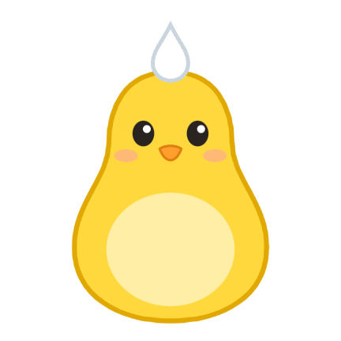
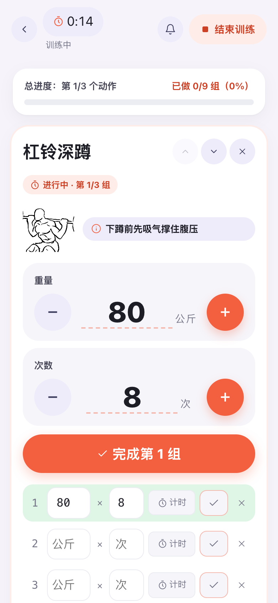
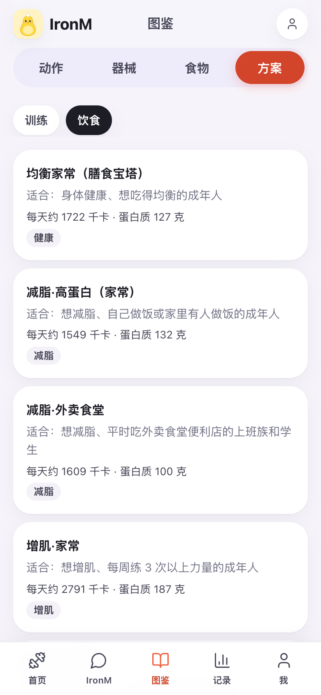
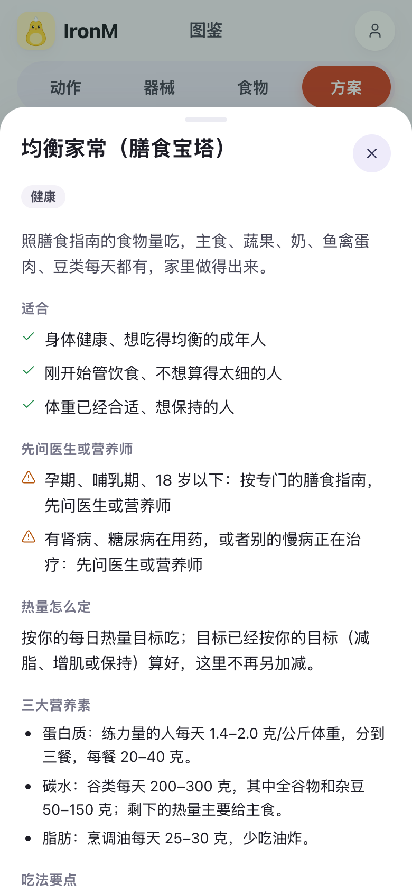
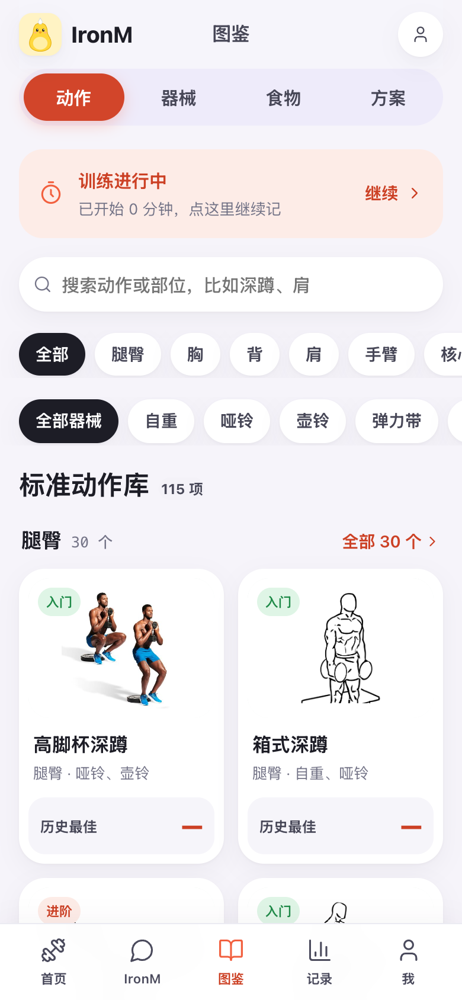

<div align="center">



# IronM

**你的健身 AI 管家：练、吃、睡，它一起看，一起安排。**

开源 · 打开网站就能用，也能自己部署 · 用你自己的大模型

**👉 现在就试：<https://test-ironm.mirobody.ai>**（不用安装，手机浏览器也能用）

[English](README.md) · **简体中文**

[](https://github.com/thetahealth/mirobody-ironm/stargazers)
[](https://github.com/thetahealth/mirobody-ironm/commits/main)
[](LICENSE)


[](https://github.com/thetahealth/mirobody)

[功能](#-能做什么) · [截图](#-截图) · [开始用](#-快速开始) · [常见问题](#-常见问题)






</div>

---

> 😴 **昨晚只睡了 5 个小时，今天还练吗？**
>
> 🐧 **IronM：** 今天照练，但按七成来，别硬顶。昨晚只睡 5 小时，最近 3 晚平均 6.5 小时，比你平时 7.2 小时少 2.2 小时；静息心率 62 次/分，和平时一样，所以不用停练，收着点练就行。

这句话里，它用了你这几晚的睡眠、你平时睡多久、你的静息心率，还知道你今天排的是哪一练。训练 App 看不到你的睡眠，手环不知道你今天要练什么，通用 AI 每次都得你从头讲一遍。IronM 三样都看得到，答完还会顺手把今天的训练调成七成。

## 🤔 为什么做 IronM

练、吃、睡本来就是连着的。没睡好，今天该练轻点；练得狠，蛋白质得跟上；减脂期体重不动，先该看的是这几周练了多少、吃了多少，而不是闷头再少吃。

可我们手里的工具是拆开的：训练 App 记组数，饮食 App 数卡路里，手环看睡眠。三边各说各的，最后还得自己在脑子里拼。

IronM 把它们放到一起，交给同一个 AI 管家。它看得到你的训练、饮食、睡眠心率和化验单，记得你的伤病、器械和作息。排计划、调今天的量、定下次的重量、改热量，都是看过全部再定；每个改动先出一张预览卡片，你点确认才生效，反悔了也能撤销。

## 🔗 一起管，管住了什么

| | 只用单一工具时 | 有了 IronM |
|---|---|---|
| 😴 **昨晚没睡好** | 训练 App 照推原计划，手环只提醒你睡少了 | 拿睡眠和静息心率跟你平时比，定今天照练、减量还是休息 |
| 🤒 **感冒发烧** | 打卡提醒照样响 | 当天停练；好了先按七成练一周，不急着回原重量 |
| ⚖️ **减脂一周体重不动** | 饮食 App 让你再少吃点 | 看 30 天体重趋势和这段时间练的、吃的，多半先不动热量，保住力量训练 |
| 💪 **想增肌** | 训练和饮食各定各的目标 | 训练计划、热量、蛋白质、饮食方案份量，全按同一个增肌目标来 |
| 🧳 **出差只有一对哑铃** | 计划没法照做，回来重排 | 这几天临时换成哑铃版，记得你膝盖伤过，到期自动回原计划 |
| 📅 **每周复盘** | 三个 App 的图表分开看 | 练了几次、吃了多少、体重、睡眠心率放一起看，再提要不要改计划或热量 |

## 💬 看它怎么回答

两周模拟测试里的真实对话：模型是 DeepSeek，用户数据是模拟的，回答一字没改。

> ⚖️ **练了一周，体重一点没动，是不是要再少吃点？**
>
> 🐧 **IronM：** 不用再少吃。一周看不出变化，你的体重这 30 天基本持平，先别动热量。最近 30 天头一周平均 66.0 公斤、最后一周 65.9 公斤，变化没超过日常波动；单次称重受水分、糖原影响，一周内本身就有约 0.35%（约 0.3 公斤）的波动。
> 1. 每天早上空腹、上完厕所后称一次，连着记两周，看周平均而不是单天
> 2. 这周三次力量照计划练，蛋白质每天 105–132 克、每餐 20–25 克，热量按 1348 千卡吃
> 3. 两周后周平均还不降，再谈减热量；一次只改一样，缺口每天不超过约 500 千卡

> 🧳 **下周一到周三要出差，酒店健身房只有一对哑铃，最重 20 公斤。**
>
> 🐧 **IronM：** 能练，这三天把周一、周三的器械动作换成哑铃版，我已经出了临时调整的预览，你确认后生效。你周一、周三的箱式深蹲、绳索划船、罗马尼亚硬拉、高位下拉都要器械，酒店只有一对哑铃。你膝盖有伤，深蹲类动作要控制下蹲深度、用轻重量，蹲到大腿接近平行就停，出现膝痛就停。
> 1. 周一：哑铃高脚杯深蹲（控制下蹲深度、用轻重量，蹲到大腿接近平行就停，膝痛就停）、哑铃卧推、单臂哑铃划船、臀桥、死虫式，组次照原计划
> 2. 周三：哑铃罗马尼亚硬拉、哑铃俯身划船、哑铃推举、高脚杯深蹲（控制下蹲深度、用轻重量，蹲到大腿接近平行就停，膝痛就停）、平板支撑，组次照原计划
> 3. 哑铃最重20公斤，重量选做完还剩2–3次的，深蹲蹲浅一点、左膝疼就停
>
> 周四回健身房后按原计划练，重量照上次的来。
>
> 下面是临时调整的预览，点「确认」才生效，到了结束日期自动回到原计划，也能提前撤销。

（回答下面跟着一张临时调整的预览卡片，点确认才生效。）

## ✨ 能做什么

### 🏋️ 训练
- 📋 **方案打底**：24 份训练方案（入门全身、上下肢分化、推拉腿、五分化、在家哑铃、壶铃、自重进阶、臀腿、三大项、力量加跑步、停练回归、出差酒店、60 岁以上……），按你的水平、天数、器械、伤病和时间改成你自己的
- 🌅 **每天看一眼**：根据睡眠、心率和你说的话，定今天怎么练
- 🧳 **临时调整**：出差、生病、减量周写好起止日期，到期自动恢复
- ⏱️ **训练记录器**：一组一组记，点数字直接填，组间休息倒计时，练完出分享卡
- 📈 **下次目标**：每个动作下次练多重，按这次的记录定
- 🏃 **有氧按热量排**：想每周多消耗多少千卡，按你的体重算出快走、慢跑、骑车各要练多久，写进计划
- 📖 **动作图鉴**：115 个动作，带配图、动图和替代动作；34 种器械，拍一张就能认

### 🥗 饮食
- 📸 **拍照 / 一句话记餐**：拍张照或说一句"中午吃了一碗牛肉面"就记下；热量按食物库算，不让模型瞎估
- 🍱 **饮食方案库**：16 份整天的饮食方案，一键套用：均衡家常、减脂高蛋白、减脂外卖食堂、减脂带饭、增肌家常、增肌带饭、增肌外卖食堂、维持期、瘦人增重、高蛋白素食、地中海、DASH 控血压、控糖、蛋奶素、60 岁以上高蛋白、限时进食。份量按你的热量目标自动缩放，不合适就撤销
- 🧮 **按你的情况自动组合**：说一句"我平时吃外卖、不吃猪肉"，IronM 从食谱里挑四顿，系统定份数，一天热量在目标上下 8% 以内、蛋白质够、没有你不吃的，确认才换
- 🎯 **目标变了跟着换**：减脂改增肌，IronM 会看饮食计划还合不合新目标，不合就出一张换方案的卡片
- 🥚 **食物库和食谱**：159 种食物、81 个食谱（家常、带饭、外卖食堂、素食、增重）、12 份外卖食堂常见餐
- 🔥 **热量目标**：按基础代谢算；要调由 IronM 看你的记录决定，代码兜住下限：不低于基础代谢，单次不超过 300 千卡，累计不超过 500 千卡

### ❤️ 身体数据
- 🧪 **化验单识别**：化验单、体检报告拍照识别（基于 [mirobody](https://github.com/thetahealth/mirobody)）
- ⌚ **手表和苹果健康**：导入数据，每项指标都跟你自己的平时比

### 🧩 还有
- 🧠 **长期记忆**：记得你的伤病、器械、作息和喜好，记错了在「我」里删掉
- 📚 **有出处**：依据库 125 条，中国居民膳食指南、国家卫健委指导原则、ACSM、ISSN、NEJM 随机试验……想知道为什么，追问一句就讲出处
- 🛡️ **安全底线**：急症、危急指标、孕期、高血压、伤处，写死在代码里
- 📦 **你的数据你做主**：随时导出，随时注销

<details>
<summary>📱 每个页面都有什么</summary>

<br/>

底部五个标签：首页、IronM、图鉴、记录、我。在做的手机 App 也是这样。

| 页面 | 内容 |
|---|---|
| 🏠 首页 | 今天练什么、调整过没有、开始训练、直接打卡；今天还能吃多少、拍照记、写一句；排行榜热搜 |
| 🐧 IronM | 对话；改计划、记一餐、改目标出预览卡片；它主动发的消息；每周周报；能发照片 |
| 📖 图鉴 | 动作、器械、食物和食谱、训练方案库、饮食方案库 |
| 📊 记录 | 本周练了几次、累计时长、PR、和上周比；身体数据趋势；训练时间线和打卡照片；成就 |
| 👤 我 | 资料和目标、器材和场所、城市和天气、身体数据、记得的事、导入数据、模型设置、账号与隐私 |
| 📋 训练计划 | 一周的安排，换动作、改组次、排顺序；每个动作的下次目标 |
| ⏱️ 训练中 | 逐组记录、休息倒计时、加一组、计时 |
| 🍱 饮食账单 | 今天的热量余额、目标怎么算的；每顿照计划记或记实际吃的；饮食计划 |

</details>

## 📸 截图

<table>
<tr>
<td align="center"><br/><sub><b>训练记录器</b><br/>点数字直接填，组间休息倒计时</sub></td>
<td align="center"><br/><sub><b>饮食方案库</b><br/>16 份整天的吃法，一键套用</sub></td>
<td align="center"><br/><sub><b>方案详情</b><br/>适合谁、热量和营养素怎么定</sub></td>
<td align="center"><br/><sub><b>动作图鉴</b><br/>115 个动作，配图和动图</sub></td>
</tr>
</table>

## 🚀 快速开始

### 🌐 直接用网站（不用安装）

1. 手机或电脑打开 <https://test-ironm.mirobody.ai>
2. 用邮箱注册（会收到验证码），再填身高、出生日期、体重
3. 「我 → 模型和 API」填上你自己的大模型密钥。DeepSeek、通义千问、智谱、豆包、Kimi、OpenAI 都行，兼容 OpenAI 接口的也行；DeepSeek 充几块钱能用很久。不填也能记训练、记饮食、看图鉴，只是不能问 IronM
4. 跟它说："我想开始练，一周三次，在健身房。"

这是测试版，会经常更新，偶尔有小毛病；特别重要的记录自己也留一份。手机上可以"添加到主屏幕"，像 App 一样打开。

### 🖥️ 自己部署一份（可选）

想让数据只留在自己电脑上，可以自己跑一份。你需要一台电脑和一个大模型密钥。

🐳 **用 Docker**（Windows、Mac、Linux）

```bash
git clone https://github.com/thetahealth/mirobody-ironm.git iron-m && cd iron-m
docker compose up -d
```

💻 **不用 Docker**（Mac、Linux）

```bash
curl -LsSf https://astral.sh/uv/install.sh | sh   # 已有 uv 可跳过，装完重开终端
git lfs install
git clone https://github.com/thetahealth/mirobody-ironm.git iron-m && cd iron-m
scripts/start.sh
```

第一次要十几分钟装环境和下载配图，之后几秒就起来。然后：

1. 打开 <http://127.0.0.1:18090/iron/>，注册，填身高、出生日期、体重
2. 「我 → 模型和 API」填上你的密钥
3. 跟它说："我想开始练，一周三次，在健身房。"

端口被占、国内下载慢、怎么更新和卸载，看 [deploy/self-host.md](deploy/self-host.md)。

## 🧠 它是怎么工作的

IronM 是单 Agent：所有问题都由同一个 AI 回答。问到哪一类，它先翻出那一类的规程（排计划、动作教学、营养、今天练不练、伤痛处理、看数据、记录复盘、建档，一共 8 份），再去查方案库、动作库、食物库、依据库和你的数据。你不在的时候它也没闲着：每天评估今天怎么练，练完定下次目标，每周复盘一次，聊完整理该记住的事。

分工很简单：**判断交给 AI，数字和底线交给代码。** 热量、基础代谢、营养素、跟你平时比的差，都由代码算；急症、危急指标、特殊人群、伤处、热量下限由代码守。AI 回答里的数字对不上出处会被退回重写；AI 出错了也不会偷偷换成规则替你决定，而是直接告诉你"出错了，可以重试"。

后端 Python 3.13 + FastAPI + PostgreSQL（pgvector），作为插件接在 [mirobody](https://github.com/thetahealth/mirobody) 上（`vendor/mirobody` 是 1.5.8 原样）；网页是原生 JavaScript，不加载外部资源。

## ❓ 常见问题

**💰 要花钱吗？** IronM 免费。模型费用走你自己的账户，用 DeepSeek 的话问一次大约一分钱。

**📱 手机上能用吗？** 能，手机浏览器打开 <https://test-ironm.mirobody.ai> 就行，页面按手机屏幕设计。手机 App 还在做（代码在 `app/`，还没上架）。

**🔒 数据存在哪？** 用网站的话，存在测试服务器的数据库里，敏感内容加密；自己部署的话，存在你自己电脑的数据库里。两种都一样：只有你问的话和拍的照片会发给你自己配置的模型服务商，查天气只发约 1 公里精度的经纬度。

**🩺 能代替教练或医生吗？** 不能，建议只供参考。有慢病、怀孕、受伤的，开练前先问医生；运动中胸痛、头晕、呼吸困难，马上停下就医。

## 🛠️ 开发

```bash
git lfs install && git lfs pull        # vendor/mirobody 里有两个 git-lfs 文件
cp .env.example .env                   # 填好后 chmod 600 .env
make setup                             # Python 环境
make pg-install pg-init                # 本机 PostgreSQL 18 + pgvector（需要 micromamba）
make run                               # http://127.0.0.1:18090
```

## 🙏 致谢

健康数据底座来自 [mirobody](https://github.com/thetahealth/mirobody)。动作配图来自 [wger](https://wger.de) 和 [Everkinetic](https://github.com/everkinetic/data)（CC BY-SA），食物照片来自 Unsplash 和 Pexels，排行榜配图来自 Wikimedia Commons，作者和许可记在 `ironm_agent/*_images.yaml`，页面上有署名；图片不在仓库里，安装时按清单下载。营养数据参考 USDA FoodData Central。

## 🤝 参与贡献

欢迎提 [Issue](https://github.com/thetahealth/mirobody-ironm/issues) 说说你用起来哪里顺手、哪里别扭，或者想要什么功能；也欢迎直接提 PR。改动大的话，先开个 Issue 聊一下方向。

## ⭐ Star 历史

[](https://star-history.com/#thetahealth/mirobody-ironm&Date)

## 📄 许可

[Apache License 2.0](LICENSE)

<div align="center">

<br/>

如果 IronM 帮到了你，欢迎给个 ⭐

</div>
